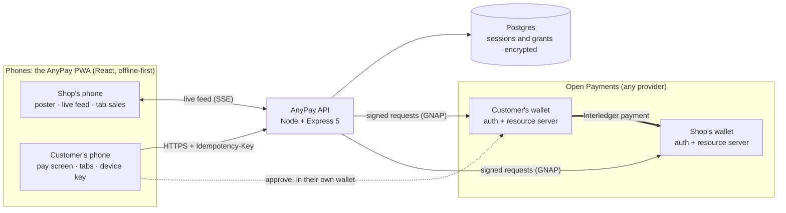
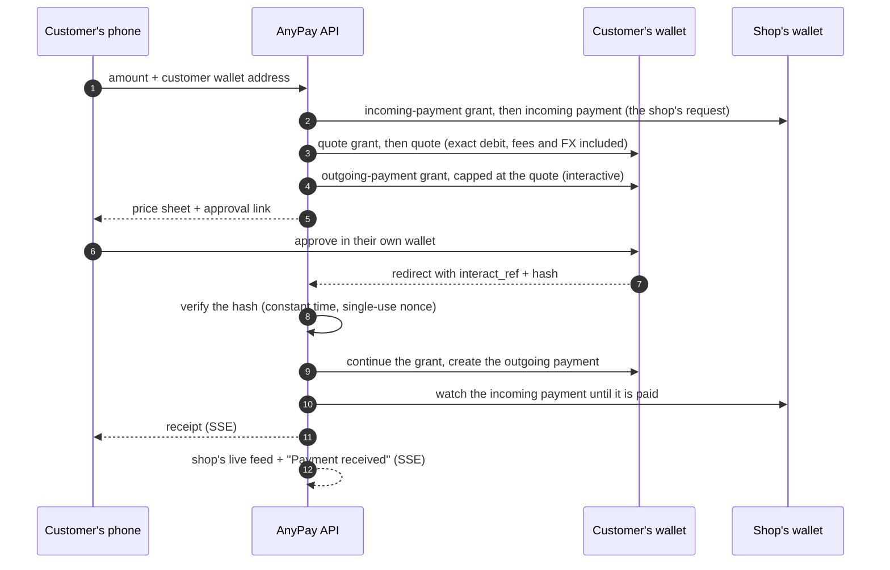

# AnyPay

**Pay any spaza from any wallet, even offline.**

Spaza shops are South Africa's corner stores: about 150 000 of them, still running mostly on cash
because card machines cost money, fees are high and each payment system works with only one
provider. AnyPay turns the shop's own phone into the till. A printed QR code takes payments from
**any** [Open Payments](https://openpayments.dev/) wallet, the shop hears "Payment received" the
moment money lands, and regulars can pay with **both phones offline** from a tab with a weekly
limit they approved in their own wallet.

Built for the Cape Town Software Development Meetup × Interledger Foundation hackathon (October to
November 2026). The brief and how AnyPay answers it: [docs/challenge.md](docs/challenge.md).

> **Live demo (test money only):** <https://anypay-web.onrender.com>
>
> The API runs on a free plan that sleeps when idle: the first request after a quiet spell can
> take about a minute. Opening <https://anypay-api.onrender.com/health> wakes it.

## Try it in five minutes (for judges)

Everything uses the Interledger **test wallet** (play money). You need two "phones": two phones,
or two different browsers on one computer (a private window works). One is the **shop**, one is
the **customer**, each with its own test wallet:

1. Make two free test wallets at <https://wallet.interledger-test.dev> (play money is added
   there). The test wallet doesn't allow paying between two wallets in the same currency, so give
   them different currencies (we use ZAR for the customer and COP for the shop).

**1. Set up a shop** (Feature 1, under two minutes)

2. Shop window: open <https://anypay-web.onrender.com/start> → type just your shop wallet's name
   (the part after `$ilp.interledger-test.dev/`) → **Check wallet** → a shop name → **Create my
   shop**. That's the A5 poster; print it or keep it on screen. **Go to my shop** opens the live
   feed; turn on **Read payments out loud**.

**2. Pay the shop** (Feature 2) **and watch it arrive** (Feature 3)

3. Customer window: open the link under the poster's QR code (or scan the QR with a phone) →
   type an amount → your customer wallet's name → **Continue**. The sheet shows exactly what
   leaves your wallet and what the shop gets, fees and exchange rate included.
4. **Approve in my wallet** → sign in to the test wallet → **Approve**. You come back to the
   receipt; the shop's feed shows the payment within seconds and reads it out.

**3. The Offline Digital Tab** (Feature 4, the innovation)

5. Customer window, on the shop's pay screen: **Open a tab at this shop** → your wallet, a name
   for the shop and a weekly limit → approve it in the test wallet (once).
6. In both windows: **Settings → Simulate offline (demo)**, or put both phones in airplane mode.
7. Shop: **Tab sale** → amount → **Show QR to customer**. Customer: **My tabs** → the tab →
   **Scan the shop's QR** (on one computer: copy the link under the QR and paste it) →
   **Approve** → a QR appears. Shop: **Scan the customer's QR** (or paste its link) →
   **Saved – settles when online**.
8. Switch Simulate offline off (or airplane mode off) in either window: the sale settles by
   itself, **once**, joins the feed with a **Tab** label and is read out.

The whole flow, with what to look for, is in [docs/testing.md](docs/testing.md).

## How it works



- **The phones never hold AnyPay's keys.** Only the API signs Open Payments requests, with
  AnyPay's own client key; customers approve in their own wallet, so AnyPay never sees their
  credentials.
- **Offline-first.** The app shell is cached by a service worker; tab sales are written to the
  phone's own database first and synced later, with a state for every item (Saved offline →
  Sending → Settled | Failed).
- **Low data.** Every screen's first load is under 200 KB (checked on every build), phones never
  poll (the server pushes over SSE), and the offline store and QR scanner download only on phones
  that use them.

### A payment, step by step



### The Offline Digital Tab

```mermaid
sequenceDiagram
  autonumber
  participant C as Customer's phone
  participant S as Shop's phone
  participant A as AnyPay API
  participant CW as Customer's wallet
  Note over C,CW: Once, online
  C->>C: make a P-256 device key (private half never leaves the phone)
  C->>A: open tab: weekly limit + public key
  A->>CW: outgoing-payment grant, limit per week (R/start/P1W), interactive
  C->>CW: approve the weekly limit
  A->>A: store the grant encrypted; measure the limit in the shop's currency
  S->>A: download the shop's tabs (keys and limits)
  Note over C,S: The sale, both phones offline
  S->>C: QR: shop, amount, nonce, time
  C->>C: check what's left, sign v1|tab|shop|amount|nonce|time
  C->>S: QR: the signed voucher
  S->>S: verify signature, freshness, single use, weekly limit
  Note over C,A: Whichever phone reconnects first
  C->>A: voucher (and later the shop sends it too)
  A->>A: claim the nonce once, verify again
  A->>CW: pay with the stored grant (no customer interaction)
  A-->>S: payment in the live feed, read out loud
```

The design choices and their reasons are in [docs/decisions.md](docs/decisions.md).

## Run it locally

You need [Node.js 22 or newer](https://nodejs.org/) (LTS) and Git. Works on Windows, macOS and Linux.

```bash
git clone https://github.com/WhiteSkyTK/anypay.git
cd anypay
npm install
```

Copy the example environment file (it works as-is for local development):

```bash
cp .env.example .env
```

On Windows PowerShell use `Copy-Item .env.example .env` instead. To make real payments, also set
`CLIENT_WALLET_ADDRESS`, `KEY_ID` and `PRIVATE_KEY` for AnyPay's own test wallet (a developer key
from the test wallet's settings; never commit it). Then start the API and the web app together:

```bash
npm run dev
```

- Web app: <http://localhost:5173>
- API health check: <http://localhost:3000/health>

No database setup is needed: without `DATABASE_URL` the API keeps its data in an embedded Postgres
(PGlite) under `.data/`. To test on real phones over Wi-Fi, see
[docs/testing.md](docs/testing.md#phase-2-on-a-real-phone-same-wi-fi-as-the-pc).

### From the terminal

`npm run demo:pay -- --amount 25.00` runs a whole real payment against the test wallet and prints
the approval link; `npm run seed` creates a demo shop and prints a private sign-in link for the
shop's phone (`--target deployed` for the live app).

## Scripts

Run from the repo root.

| Command                              | What it does                                                          |
| ------------------------------------ | --------------------------------------------------------------------- |
| `npm run dev`                        | API (port 3000) and web app (port 5173) with live reload              |
| `npm run dev:lan`                    | Same, with the web app reachable from phones on your Wi-Fi            |
| `npm run build`                      | Production builds, plus the web bundle size against the 200 KB budget |
| `npm run lint`                       | ESLint, including SonarCloud's rules (eslint-plugin-sonarjs)          |
| `npm run format`                     | Format everything with Prettier (`format:check` only checks)          |
| `npm run typecheck`                  | TypeScript in strict mode, all workspaces                             |
| `npm test`                           | Vitest across all workspaces (`test:coverage` adds an lcov report)    |
| `npm run preview -w @anypay/web`     | Serve the production web build, to test the PWA and offline mode      |
| `npm run demo:pay -- --amount 25.00` | A real test-wallet payment from the terminal                          |
| `npm run seed`                       | A demo shop on `DEMO_MERCHANT_WALLET`, with its sign-in and pay links |

A change is done when `npm run lint && npm test && npm run build` passes. CI runs the same checks
on Ubuntu and Windows for every pull request, and SonarCloud checks quality and security.

## Project structure

```
apps/
  api/        Node + Express 5 API (TypeScript, one composition root; only the gateway imports the SDK)
  web/        React + Vite PWA (Tailwind CSS v4, shadcn/ui, React Router, i18next, Dexie)
packages/
  shared/     Money utils, zod schemas and the voucher protocol, used by both apps
docs/
  challenge.md   The brief and how AnyPay answers it
  decisions.md   Why things are built the way they are
  deploy.md      Render + Neon deployment, and the security checklist
  testing.md     What to test, and how
```

## Security, privacy and accessibility

- **Secrets** live only in environment settings, validated at startup; grant tokens, payment
  sessions and customers' wallet addresses are stored AES-256-GCM encrypted.
- **Every money-moving request** carries an `Idempotency-Key`; a retried request returns the first
  result. Wallet approval callbacks are verified (hash, single-use nonce) before anything is paid.
- **Wallet addresses are untrusted input:** an allowlist of hosts, no IP literals or private
  ranges (no SSRF). Rate limits on every route, a Content-Security-Policy, and only `https`
  approval pages are ever opened. Details: [docs/deploy.md](docs/deploy.md#security-checklist).
- **Accessible:** semantic landmarks, labelled inputs, managed focus, status never shown by colour
  alone, usable at 200% text size, reduced motion respected, voice confirmation.
- **Languages:** English, Sepedi, isiXhosa and isiZulu; every string exists in every language
  (tested). The non-English text still needs a native speaker's review.

## Known limitations

- **Test money only.** The API allows wallets on `interledger-test.dev`; other Open Payments
  providers work by adding their host to `ALLOWED_WALLET_HOSTS`.
- **Free hosting sleeps.** The first request after a quiet spell takes about a minute.
- **One API instance.** The live feed and rate limits are held in memory, which is fine for a
  pilot; more instances need a shared bus (e.g. Postgres LISTEN/NOTIFY) and a shared rate-limit
  store.
- **Offline limit checks are close, not exact.** The weekly limit is converted to the shop's
  currency when the tab opens. If exchange rates move, the customer's wallet (which holds the
  real limit) can still refuse a voucher, and the sale shows as failed with that reason.
- **One phone per tab, one sign-in link per shop.** A tab's key lives on the phone that opened it;
  a shop moves to another phone with its sign-in link.
- **On an iPhone with AnyPay installed,** the camera app opens links in Safari, which doesn't have
  the tab's key: use the in-app scanner there.

## Next steps

- Pilot with spaza owners, then more wallet providers in the allowlist.
- Stokvel group pot (recurring grants) and cross-border "send home" payments.
- Merchant accounts that span phones, and push notifications for a shop that has closed the app.

## Acknowledgements

- [Interledger Foundation](https://interledger.org/) for Open Payments, the
  [test wallet](https://wallet.interledger-test.dev) and the
  [`@interledger/open-payments`](https://github.com/interledger/open-payments) SDK; the Cape Town
  Software Development Meetup for the hackathon.
- Libraries: React, React Router, Vite, vite-plugin-pwa (Workbox), Tailwind CSS, shadcn/ui and
  Radix UI, vaul, Motion, lucide-react, i18next, Dexie, qr-scanner, qrcode, zod, Express, helmet,
  express-rate-limit, pino, Drizzle ORM, PGlite, postgres.js, Vitest, Testing Library,
  happy-dom, fake-indexeddb, ESLint (with eslint-plugin-sonarjs) and Prettier.
- Built with [Claude Code](https://claude.com/claude-code) as an AI pair programmer, alongside the
  team's own design, testing and research.
