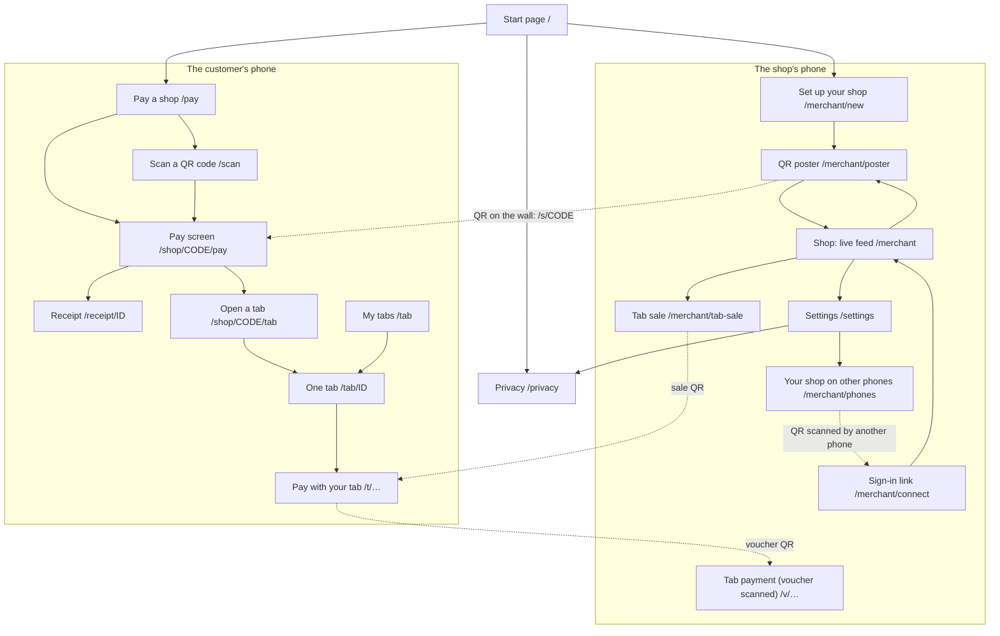
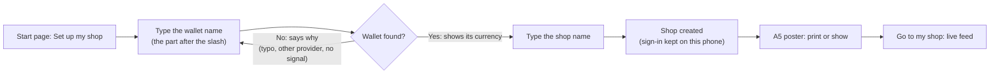
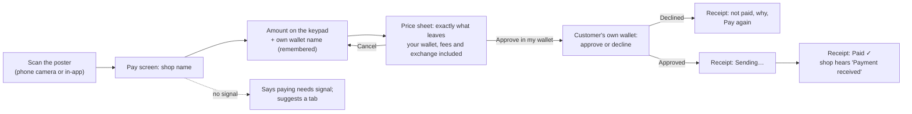
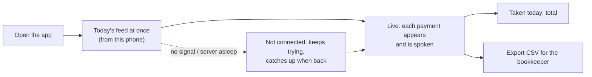
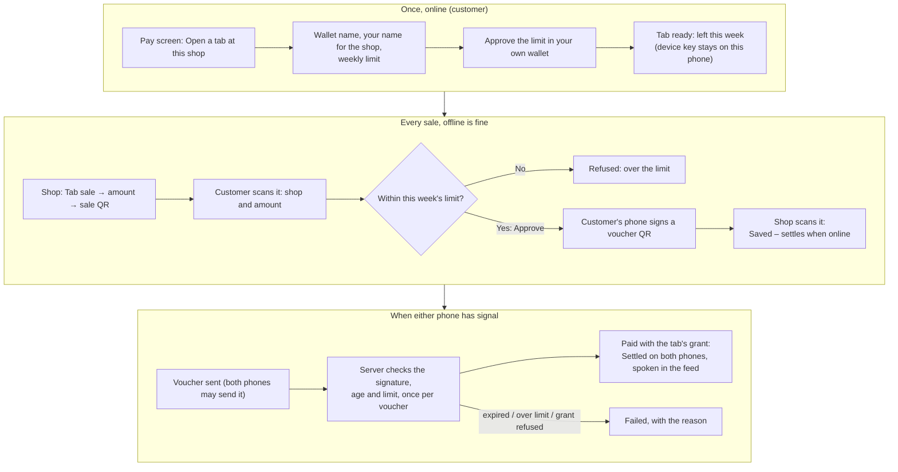

# Screens and user flows (as built)

What the app does today, screen by screen, for the "information architecture" and "user flows"
items in the research track. They describe the product, not users: pain points and emotions per
step come from the interviews and usability tests ([interview-guide.md](interview-guide.md),
[usability-test.md](usability-test.md)). The system architecture and the Open Payments sequence
diagrams are in the [README](../../README.md#how-it-works).

## Screen map

Three kinds of screen: the start page; the shop's screens, with a tab bar (Shop · Tab ·
Settings); and focused screens opened from a QR code or link, with no tab bar so nothing
distracts from paying.

## Feature 1: setting up a shop (under two minutes)

## Feature 2: paying a shop online

## Feature 3: the shop's live feed

## Feature 4: the Offline Digital Tab

Once, with signal, the customer opens a tab and approves a weekly limit in their own wallet.
After that, a sale needs no signal on either phone.

